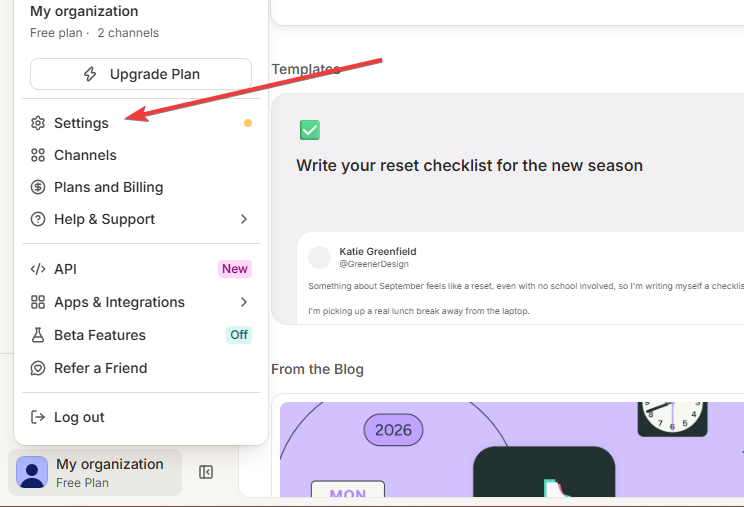
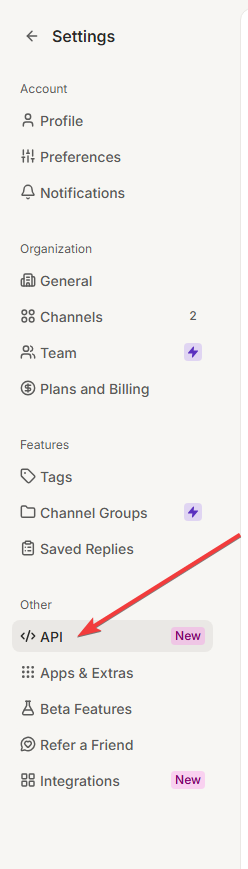
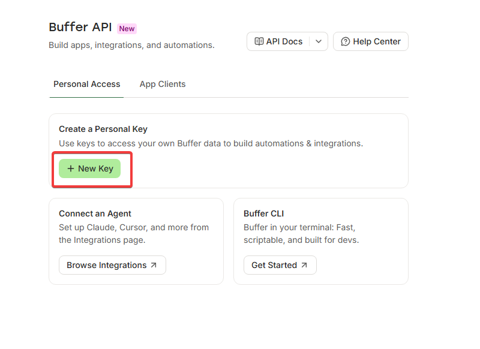
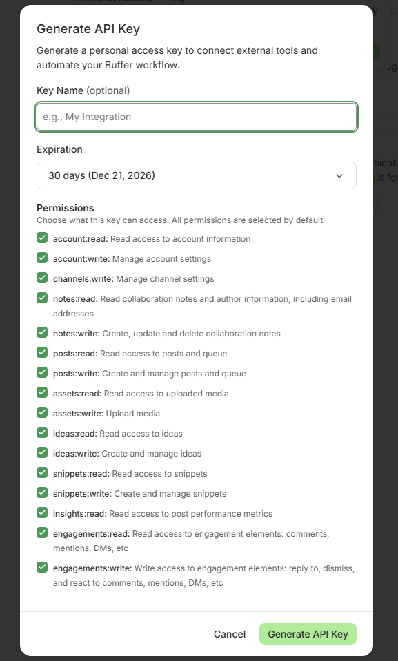
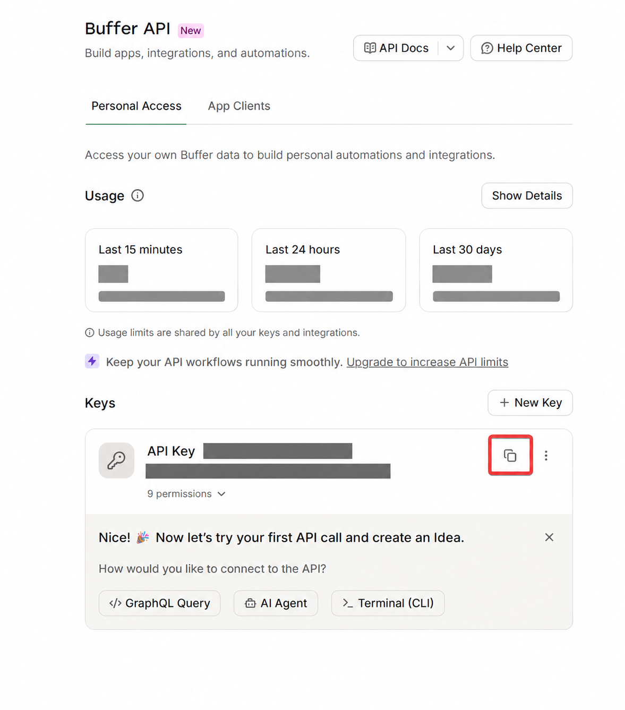

# Get a Buffer API key for JetVideo

JetVideo uses the key to find your TikTok channel in Buffer and send videos to its queue. Sign in to Buffer and verify your email address if you haven't already done so.

In JetVideo help, click a screenshot to open it in its own window. Use **100%** or **Ctrl + scroll** to read small text.

## 1. Open the API settings

1. In Buffer, click the profile icon or organization name in the bottom-left corner. Choose **Settings**. If this menu already shows **API**, you can click it directly.

2. In the settings sidebar, scroll to **Other** and click **API**. You can also open the page directly. [Buffer API settings](https://publish.buffer.com/settings/api)

## 2. Create and copy your key

1. On the **Buffer API** page, open **Personal Access**. If Buffer asks you to switch organizations, click **Switch Organization** and select your personal organization.
2. Click **+ New Key**. For your first key, the button is under **Create a Personal Key**. If you already have keys, look under **Keys**.

3. In **Generate API Key**, enter `JetVideo` in the optional **Key Name** field and choose an **Expiration** period. If you customize **Permissions**, keep `account:read`, `posts:read`, and `posts:write`. Keep `insights:read` as well if you use **Statistics**. Click **Generate API Key** at the bottom.

4. Click the copy icon to the right of the key. Buffer displays only the last few characters, but the button copies the full key. You can use it to copy an existing active key as well.

[Buffer's official guide to creating an API key](https://support.buffer.com/en-us/articles/how-to-create-your-buffer-api-key-ShIgYVwM6j)

## 3. Paste the key into JetVideo

1. Open **Publishing → Connections**. Paste the full key into **Buffer API Key** as copied.
2. Fill in the remaining fields using the R2 guide, then click **Save connections**. [Cloudflare R2 setup](R2_SETUP.md)
3. Under **Accounts**, choose **Link Buffer → Find in Buffer**. Select your TikTok channel and click **Save channel link**. Return to **Connections** and click **Test connections**.
