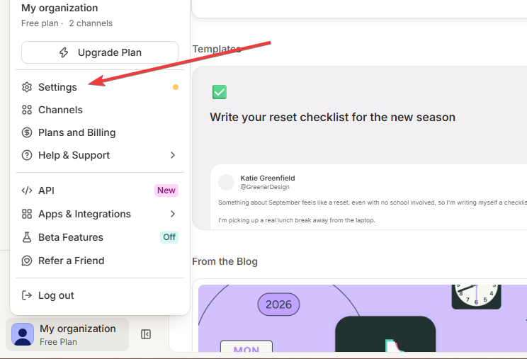
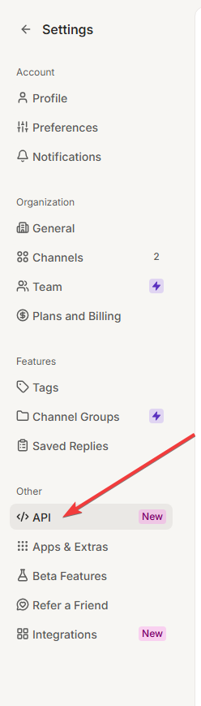
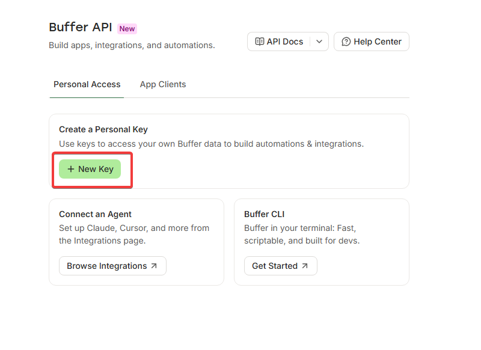
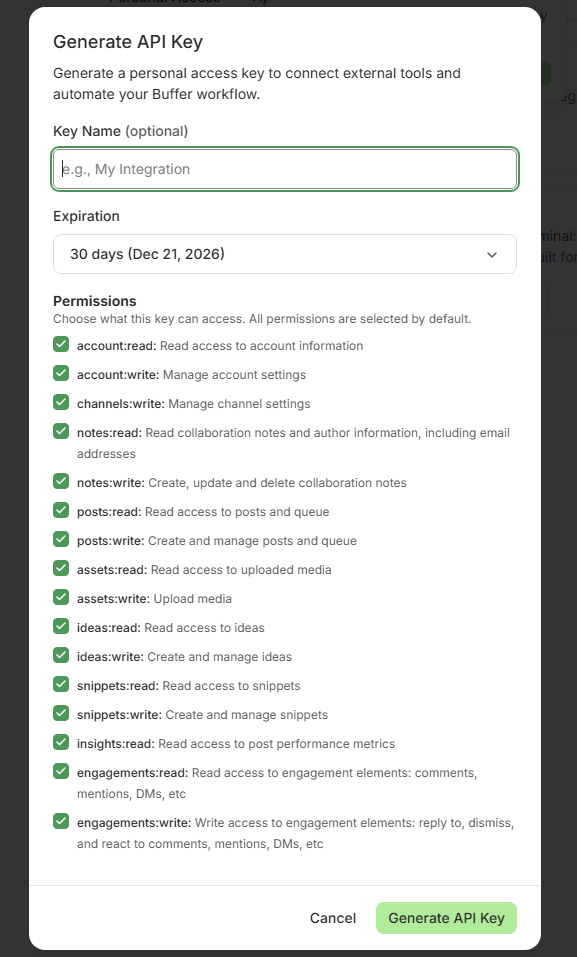
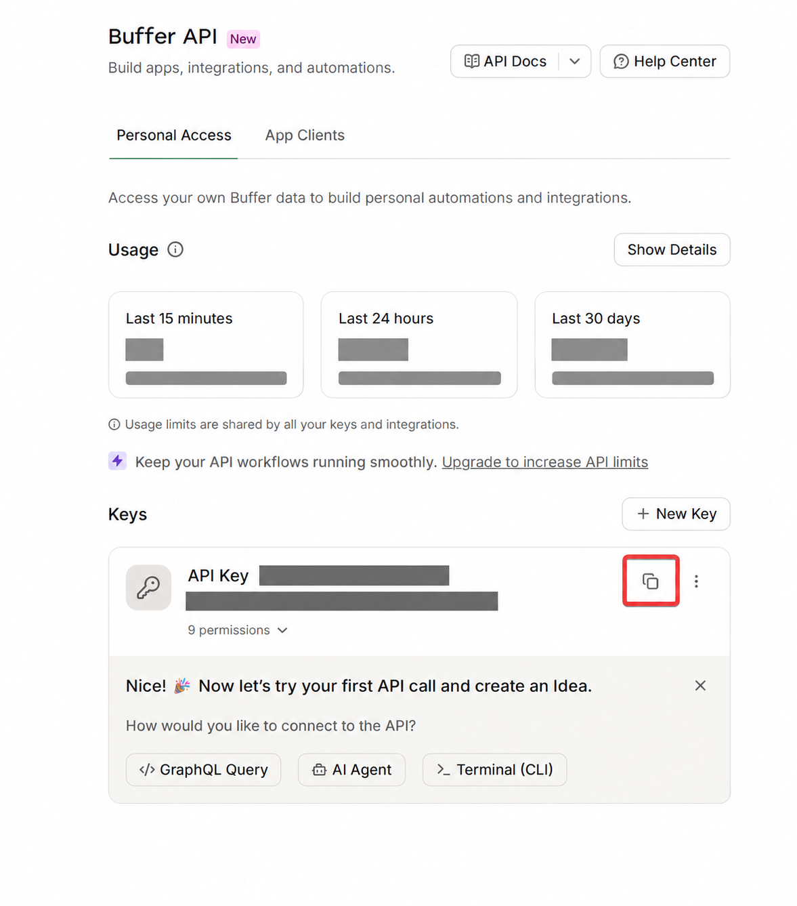

# Как получить ключ Buffer для JetVideo

Ключ позволяет JetVideo найти ваш TikTok-канал в Buffer и отправлять видео в его очередь. Войдите в Buffer и подтвердите почту, если ещё этого не сделали.

В справке JetVideo нажмите на скриншот, чтобы открыть его в отдельном окне. Для мелкого текста используйте **100%** или **Ctrl + колёсико**.

## 1. Откройте настройки API

1. В Buffer нажмите на значок профиля или название организации в левом нижнем углу. Выберите **Settings**. Если в этом меню уже есть **API**, можно сразу нажать на него.

2. В левом меню настроек найдите блок **Other** и нажмите **API**. Эту же страницу можно открыть напрямую. [Настройки API Buffer](https://publish.buffer.com/settings/api)

## 2. Создайте и скопируйте ключ

1. На странице **Buffer API** откройте вкладку **Personal Access**. Если Buffer предлагает переключить организацию, нажмите **Switch Organization** и выберите свою личную организацию.
2. Нажмите **+ New Key**. При создании первого ключа кнопка находится в блоке **Create a Personal Key**. Если вы уже создавали ключи, ищите кнопку в блоке **Keys**.

3. В окне **Generate API Key** введите `JetVideo` в необязательное поле **Key Name** и выберите срок действия в **Expiration**. Если настраиваете **Permissions** вручную, оставьте `account:read`, `posts:read` и `posts:write`. Для раздела **Статистика** также оставьте `insights:read`. Нажмите **Generate API Key** внизу окна.

4. Нажмите значок копирования справа от ключа. Buffer показывает на экране только последние символы, а кнопка копирует ключ целиком. Так же можно скопировать уже созданный действующий ключ.

[Официальная инструкция Buffer по созданию ключа](https://support.buffer.com/en-us/articles/how-to-create-your-buffer-api-key-ShIgYVwM6j)

## 3. Вставьте ключ в JetVideo

1. Откройте **Публикации → Подключения**. Вставьте скопированный ключ в поле **Buffer API Key** как есть.
2. Заполните остальные поля по инструкции R2 и нажмите **Сохранить подключения**. [Настройка Cloudflare R2](R2_SETUP.ru.md)
3. В разделе **Аккаунты** выберите **Привязать Buffer → Найти в Buffer**. Выберите свой TikTok-канал и нажмите **Сохранить привязку**. Вернитесь в **Подключения** и нажмите **Проверить подключения**.
