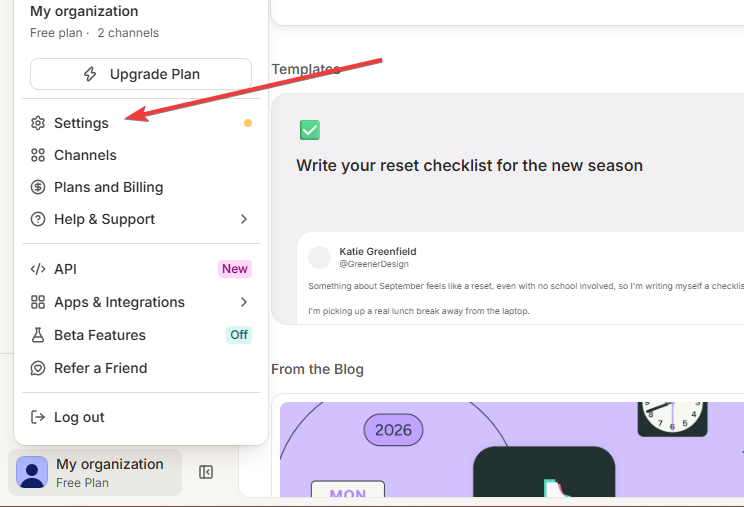
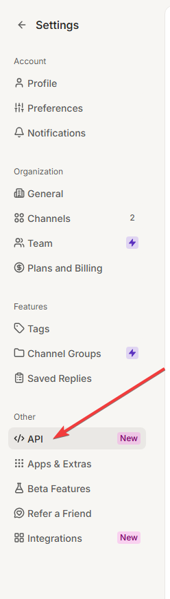
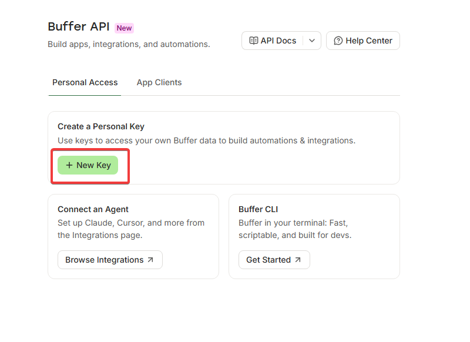
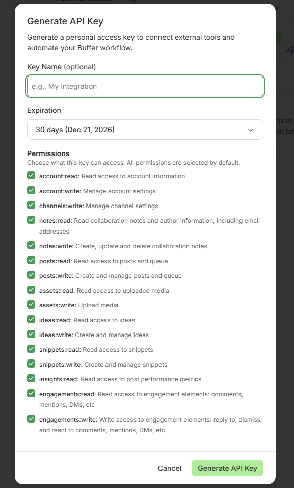
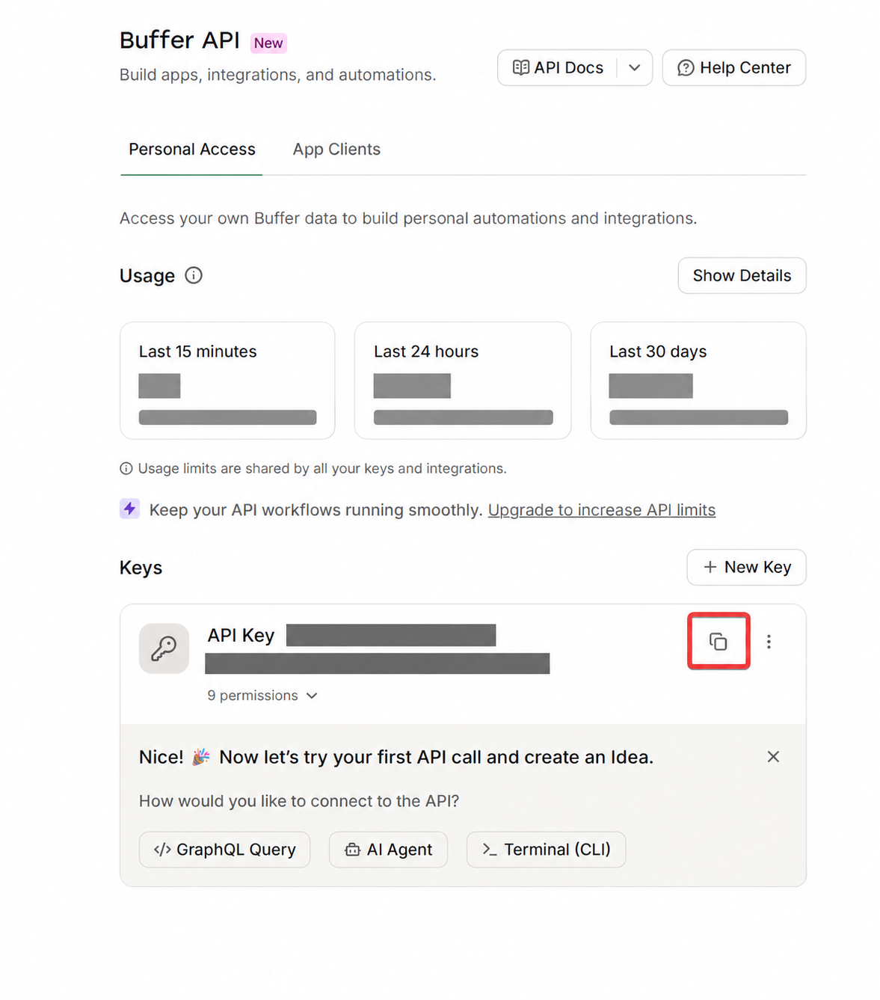

# Як отримати ключ Buffer для JetVideo

Ключ дає JetVideo змогу знайти ваш канал TikTok у Buffer і надсилати відео до його черги. Увійдіть у Buffer і підтвердьте електронну пошту, якщо ще цього не зробили.

У довідці JetVideo натисніть на знімок, щоб відкрити його в окремому вікні. Для дрібного тексту скористайтеся кнопкою **100%** або комбінацією **Ctrl + коліщатко**.

## 1. Відкрийте налаштування API

1. У Buffer натисніть значок профілю або назву організації в лівому нижньому куті. Виберіть **Settings**. Якщо в цьому меню вже є пункт **API**, можна одразу натиснути на нього.

2. У лівому меню налаштувань знайдіть блок **Other** і натисніть **API**. Цю сторінку також можна відкрити напряму. [Налаштування API Buffer](https://publish.buffer.com/settings/api)

## 2. Створіть і скопіюйте ключ

1. На сторінці **Buffer API** відкрийте вкладку **Personal Access**. Якщо Buffer пропонує змінити організацію, натисніть **Switch Organization** і виберіть свою особисту організацію.
2. Натисніть **+ New Key**. Під час створення першого ключа кнопка розташована в блоці **Create a Personal Key**. Якщо ви вже створювали ключі, шукайте її в блоці **Keys**.

3. У вікні **Generate API Key** введіть `JetVideo` в необов’язкове поле **Key Name** та виберіть строк дії в **Expiration**. Якщо налаштовуєте **Permissions** вручну, залиште `account:read`, `posts:read` і `posts:write`. Для розділу **Статистика** також залиште `insights:read`. Натисніть **Generate API Key** внизу вікна.

4. Натисніть значок копіювання праворуч від ключа. Buffer показує лише останні символи, а кнопка копіює ключ повністю. Так само можна скопіювати вже створений чинний ключ.

[Офіційна інструкція Buffer зі створення ключа](https://support.buffer.com/en-us/articles/how-to-create-your-buffer-api-key-ShIgYVwM6j)

## 3. Вставте ключ у JetVideo

1. Відкрийте **Публікації → Підключення**. Вставте скопійований ключ у поле **Buffer API Key** як є.
2. Заповніть решту полів за посібником R2 і натисніть **Зберегти підключення**. [Налаштування Cloudflare R2](R2_SETUP.uk.md)
3. У розділі **Акаунти** виберіть **Прив’язати Buffer → Знайти в Buffer**. Виберіть свій канал TikTok і натисніть **Зберегти прив’язку**. Поверніться в **Підключення** та натисніть **Перевірити підключення**.
