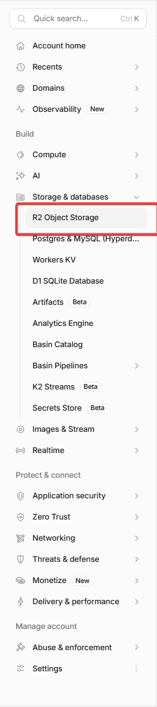
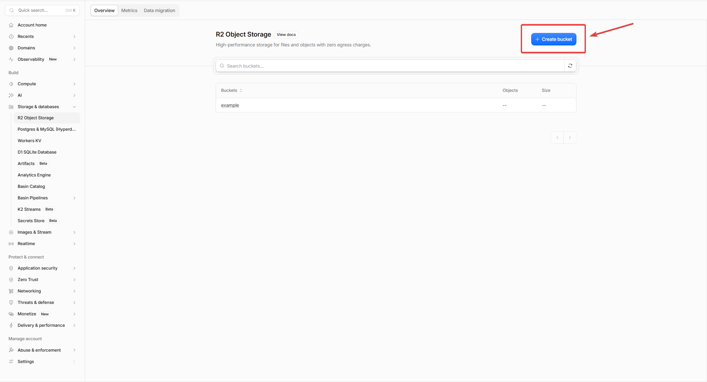
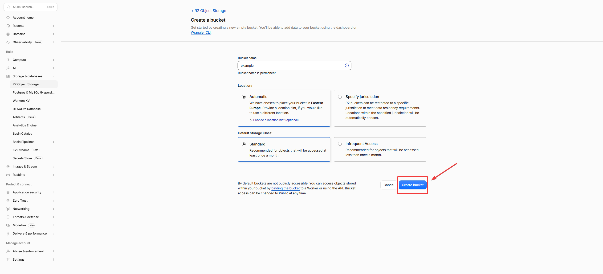
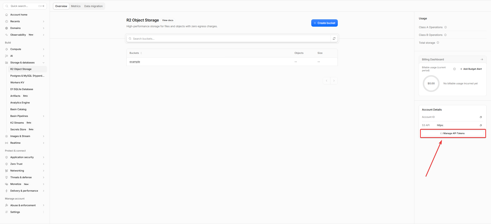
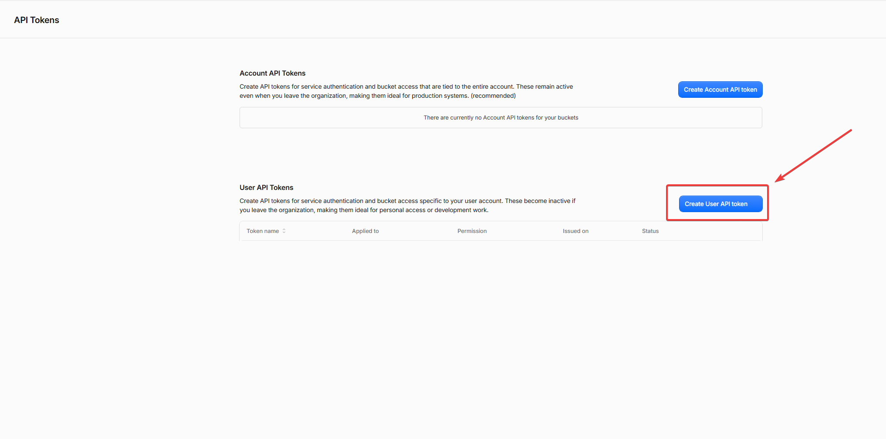
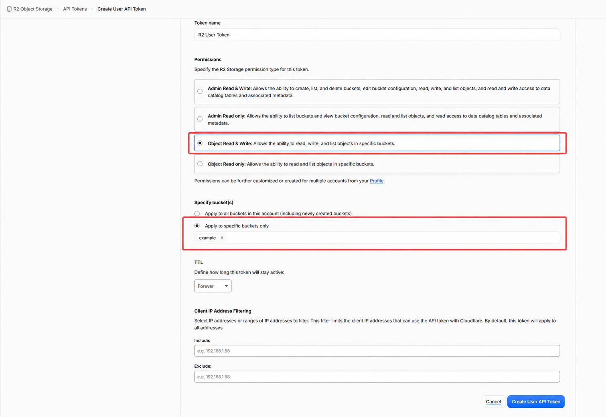
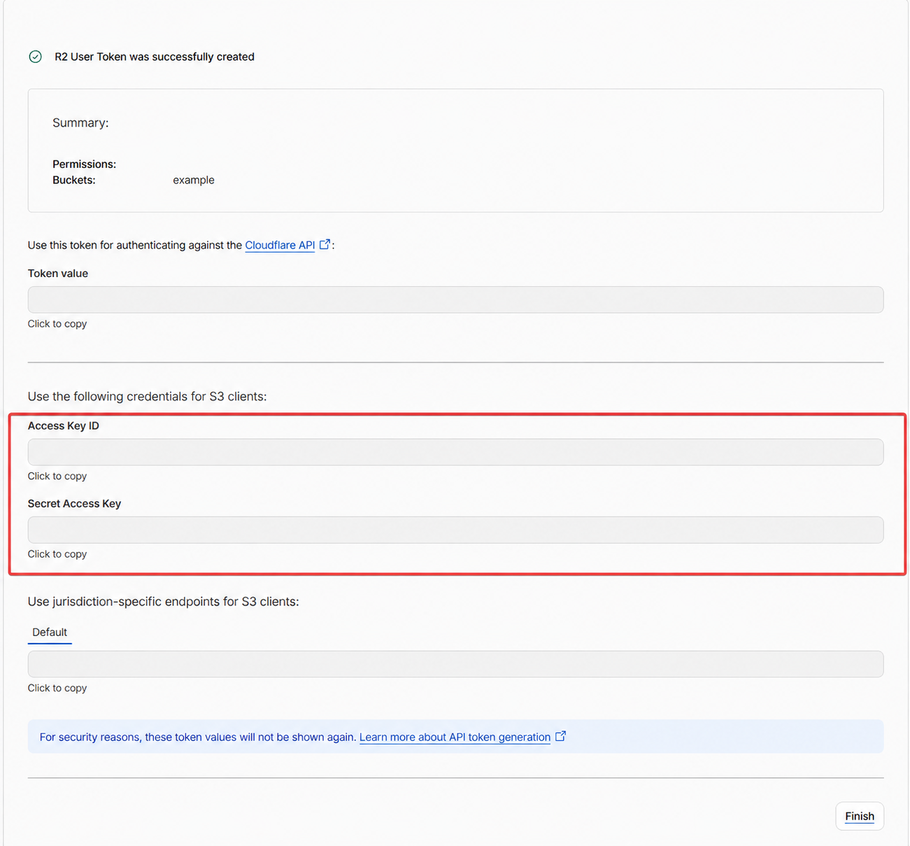
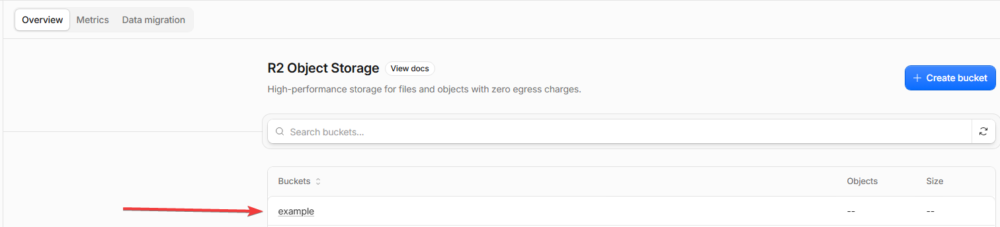
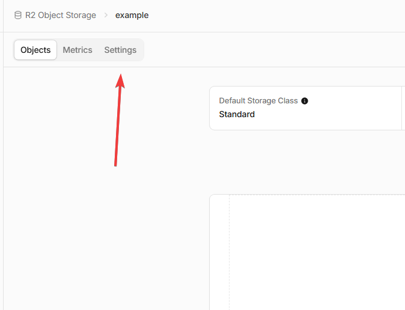

# Set up Cloudflare R2 for JetVideo

[Русский](R2_SETUP.ru.md) · [Українська](R2_SETUP.uk.md) · [Main guide](../README.md)

**R2 stores your videos until publication.** JetVideo uploads them to your bucket, then Buffer fetches them by URL and publishes them to TikTok on your schedule. You can split and edit videos on your computer without R2 or Buffer.

The screenshots use a bucket named **example**. Use your own bucket name.

In JetVideo help, click a screenshot or its caption. To read small text, click **100%** or **+**, or hold **Ctrl** and scroll. Drag the enlarged screenshot to move around it. Click **Fit** to see the whole screenshot again.

## 1. Create a bucket

1. Sign in to the [Cloudflare dashboard](https://dash.cloudflare.com/). On the left, open **Storage & databases** → **R2 Object Storage**. If Cloudflare asks you to activate R2, complete that setup first.

2. Click **Create bucket**. A bucket is a container for files, similar to a folder in the cloud.

3. Enter a **Bucket name** such as `jetvideo-media`. Use lowercase letters, numbers and hyphens. Leave **Automatic** and **Standard** selected, then click **Create bucket**. Keep the exact name for **R2 Bucket** in JetVideo.

[Cloudflare bucket creation guide](https://developers.cloudflare.com/r2/buckets/create-buckets/)

## 2. Create credentials for JetVideo

1. Return to **R2 Object Storage → Overview**. Under **Account Details** on the right, click **Manage API Tokens**.

2. Under **User API Tokens**, click **Create User API token**.

3. Name the token, for example `JetVideo`. Under **Permissions**, choose **Object Read & Write**. Choose **Apply to specific buckets only** and select your new bucket. Click **Create User API Token**. Read-only access cannot upload videos, and admin access is unnecessary.

4. Under **Use the following credentials for S3 clients**, copy **Access Key ID** and **Secret Access Key**. Copy the **S3 endpoint** under **Default** if you used **Automatic** when creating the bucket. The endpoint is also available as **S3 API** on the R2 overview.

Copy the secret key before closing the page. Cloudflare only shows it once. JetVideo needs the two S3 credentials, so leave the separate **Token value** unused. Store the keys privately and enter them in your copy of JetVideo. [Cloudflare R2 authentication](https://developers.cloudflare.com/r2/api/tokens/)

## 3. Get the public URL for Buffer

1. Open **R2 Object Storage** and click your bucket name.

2. Open the **Settings** tab.

3. For a test post, scroll to **Public Development URL** and click **Enable**. Type `allow` in the confirmation dialog and click **Allow**. Copy the HTTPS address, which looks like `https://pub-<your-id>.r2.dev`. This is your **R2 Public URL**. If you already connected a public domain under **Custom Domains**, use its HTTPS address. Cloudflare recommends a custom domain for production use.

Anyone with an object link can access the file. Keep this bucket for videos you intend to publish and leave the media accessible until the post goes out. [Cloudflare public access](https://developers.cloudflare.com/r2/buckets/public-buckets/) · [Buffer media requirements](https://developers.buffer.com/guides/hosting-media.html)

## 4. Fill in Connections in JetVideo

Open **Publishing** → **Connections**. Paste the actual values, without surrounding spaces or quotes.

| Field in JetVideo | Where to get the value |
| --- | --- |
| **Buffer API Key** | Personal key from Buffer. [How to get a Buffer API key](BUFFER_SETUP.md) |
| **R2 Endpoint** | **S3 API** from Cloudflare, in the form `https://<account-id>.r2.cloudflarestorage.com`. Copy it without appending the bucket name. |
| **R2 Access Key ID** | **Access Key ID** from the S3 credentials. |
| **R2 Secret Access Key** | **Secret Access Key** from the S3 credentials. |
| **R2 Bucket** | The exact bucket name, for example `jetvideo-media`. |
| **R2 Public URL** | HTTPS address from **Public Development URL** or your public custom domain, without a filename. |

JetVideo uploads through **R2 Endpoint**. Buffer retrieves the file through **R2 Public URL**. Copy the two addresses from their respective sections in Cloudflare. [Buffer API key instructions](https://developers.buffer.com/guides/authentication.html)

## 5. Test the connection

1. Click **Save connections**. Make sure your TikTok channel is already connected in Buffer.
2. In JetVideo, open **Accounts** → **Link Buffer** → **Find in Buffer**, select your channel and click **Save channel link**.
3. Return to **Connections** and click **Test connections**. JetVideo checks Buffer, writes a small R2 test file and reads it through the public URL. It then attempts to remove the test file. Open the **Activity log** to see the result. This test creates no posts.

| What you see | What to check |
| --- | --- |
| **403 / AccessDenied / R2 credentials/bucket error** | Check that the key has **Object Read & Write** for your bucket. Verify the bucket name, credentials and endpoint. |
| **The R2 API works but the public URL fails** | Check the **R2 Public URL** and public access in **Settings**. The bucket URL alone may show no file list. JetVideo tests a link to a specific file. |
| **TikTok channel missing** | Connect the channel in Buffer and select it in **Accounts**. Make sure the key belongs to the intended Buffer account. |

Once the test passes, continue to **Schedule a post** in the [main guide](../README.md).
