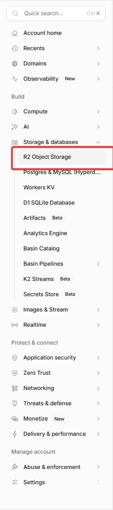
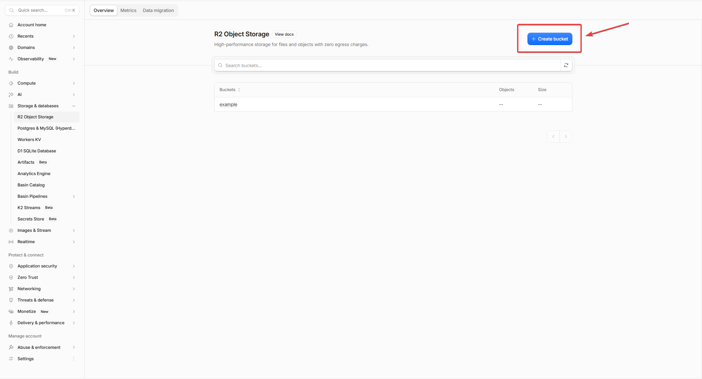
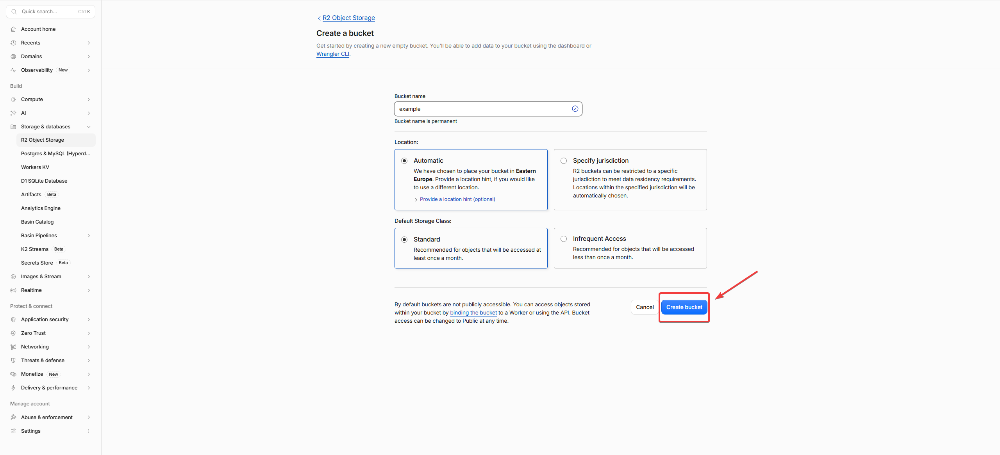
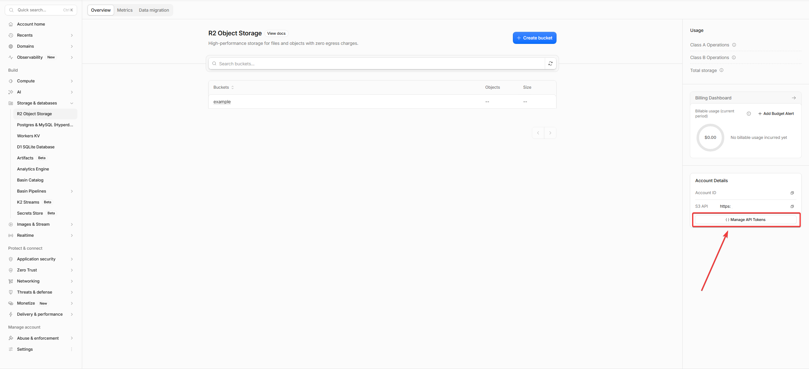
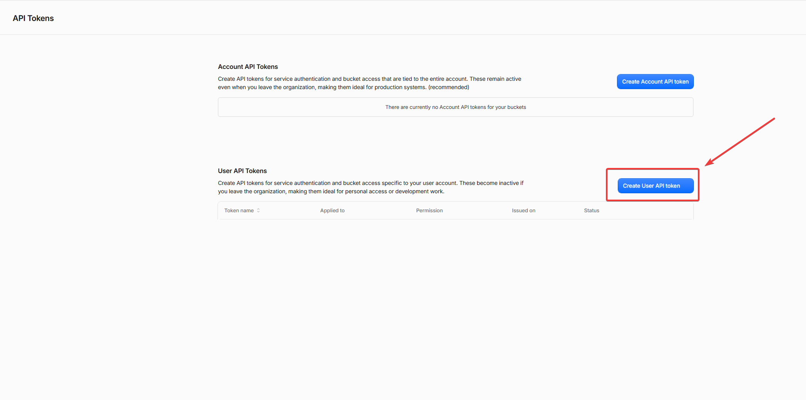
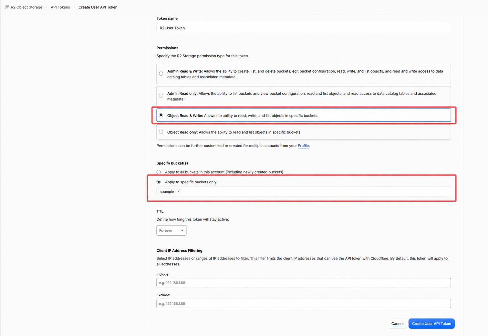
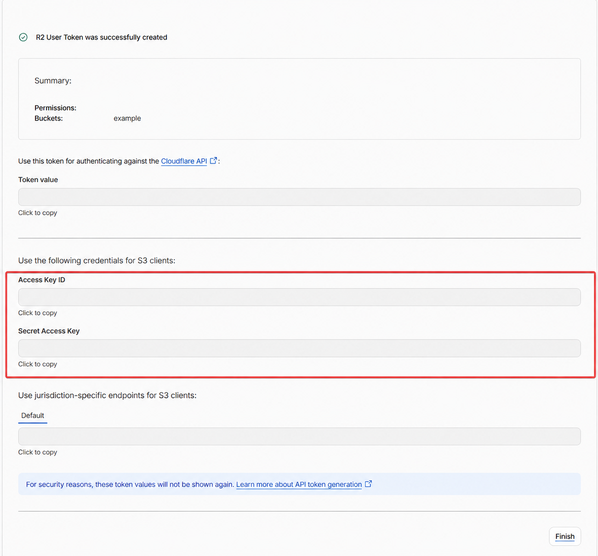
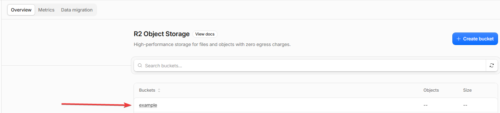
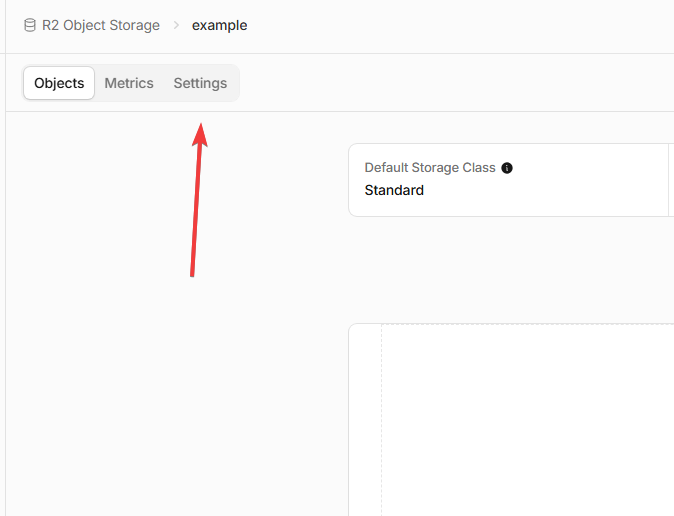

# Как подключить Cloudflare R2 к JetVideo

[English](R2_SETUP.md) · [Українська](R2_SETUP.uk.md) · [К основному руководству](../README.ru.md)

**R2 — хранилище, куда JetVideo загружает видео перед публикацией.** Buffer забирает видео по ссылке и отправляет его в TikTok по расписанию. Для нарезки и монтажа на компьютере R2 и Buffer не нужны.

На скриншотах хранилище названо **example**. У вас будет своё имя.

В справке JetVideo нажмите на скриншот или его подпись. Чтобы прочитать мелкий текст, нажмите **100%**, **+** или прокрутите колёсико с зажатым **Ctrl**. Увеличенный скриншот можно двигать мышью. Кнопка **Вписать** снова покажет весь снимок.

## 1. Создайте bucket

1. Войдите в [панель Cloudflare](https://dash.cloudflare.com/). Слева раскройте **Storage & databases** → **R2 Object Storage**. Если Cloudflare предложит подключить R2, завершите подключение, чтобы открыть страницу хранилища.

2. Нажмите **Create bucket**. Bucket — это отдельное хранилище файлов, похожее на папку в облаке.

3. В **Bucket name** введите, например, `jetvideo-media`. Используйте строчные латинские буквы, цифры и дефисы. Оставьте **Automatic** и **Standard**. Нажмите **Create bucket** ещё раз. Запомните точное имя: оно понадобится для поля **R2 Bucket**.

[Документация Cloudflare по созданию bucket](https://developers.cloudflare.com/r2/buckets/create-buckets/)

## 2. Создайте ключи для JetVideo

1. Вернитесь на страницу **R2 Object Storage → Overview**. Справа в **Account Details** нажмите **Manage API Tokens**.

2. В блоке **User API Tokens** нажмите **Create User API token**.

3. Укажите имя ключа, например `JetVideo`. В **Permissions** выберите **Object Read & Write**. Затем выберите **Apply to specific buckets only** и добавьте только созданный bucket. Нажмите **Create User API Token**.

**Важно: с Object Read only JetVideo не сможет загрузить видео.** На иллюстрации выбрано правильное разрешение **Object Read & Write**. Доступ администратора для этого не требуется.

4. На итоговой странице найдите блок **Use the following credentials for S3 clients** и скопируйте **Access Key ID** и **Secret Access Key**. Ниже скопируйте **S3 endpoint** из **Default**, если при создании bucket оставили **Automatic**. Он также указан как **S3 API** на странице **Overview**.

Скопируйте **Secret Access Key** до закрытия страницы. Cloudflare больше не покажет его. Поле **Token value** из верхнего блока для JetVideo не нужно. Храните ключи в личном сейфе паролей и вводите их только в своей копии JetVideo. [Ключи S3 для R2](https://developers.cloudflare.com/r2/api/tokens/)

## 3. Получите публичный адрес для Buffer

1. Вернитесь в **R2 Object Storage** и нажмите на имя своего bucket в списке.

2. Откройте вкладку **Settings**.

3. Для пробной публикации найдите **Public Development URL** и нажмите **Enable**. Введите `allow` в окне подтверждения и нажмите **Allow**. Скопируйте показанный HTTPS-адрес вида `https://pub-<ваш-код>.r2.dev`. Это **R2 Public URL**. Если уже подключён публичный домен в **Custom Domains**, используйте его HTTPS-адрес. Cloudflare рекомендует свой домен для регулярной работы.

Файлы из этого bucket будут доступны людям, у которых есть ссылка. Загружайте туда только видео, предназначенные для публикации. Buffer должен иметь доступ по ссылке до выхода поста. [Публичный доступ в Cloudflare](https://developers.cloudflare.com/r2/buckets/public-buckets/) · [Требования Buffer к ссылкам](https://developers.buffer.com/guides/hosting-media.html)

## 4. Заполните поля в JetVideo

Откройте **Публикации** → **Подключения**. Копируйте свои значения без кавычек и пробелов по краям.

| Поле в JetVideo | Что вставить |
| --- | --- |
| **Buffer API Key** | Личный ключ из Buffer. [Как получить ключ Buffer](BUFFER_SETUP.ru.md) |
| **R2 Endpoint** | Адрес **S3 API** из Cloudflare, например `https://<account-id>.r2.cloudflarestorage.com`. Укажите только адрес из панели Cloudflare, без имени bucket в конце. |
| **R2 Access Key ID** | Значение **Access Key ID** из блока S3. |
| **R2 Secret Access Key** | Значение **Secret Access Key** из блока S3. |
| **R2 Bucket** | Точное имя хранилища, например `jetvideo-media`. |
| **R2 Public URL** | HTTPS-адрес из **Public Development URL** или адрес подключённого публичного домена, без имени файла. |

**Как не перепутать два адреса:** JetVideo загружает файл через **R2 Endpoint**, а Buffer забирает его через **R2 Public URL**. Скопируйте оба адреса из соответствующих разделов. Примеры в таблице показывают только формат. [Где найти ключ Buffer](https://developers.buffer.com/guides/authentication.html)

## 5. Проверьте подключение

1. Нажмите **Сохранить подключения**. Убедитесь, что канал TikTok уже подключён в Buffer.
2. В JetVideo откройте **Аккаунты** → **Привязать Buffer** → **Найти в Buffer**, выберите нужный канал и нажмите **Сохранить привязку**.
3. Вернитесь в **Подключения** и нажмите **Проверить подключения**. JetVideo проверит Buffer, запишет временный файл в R2 и прочитает его по публичной ссылке. По завершении программа попытается удалить проверочный файл. Результат появится в **Журнале действий**. Проверка не создаёт пост.

| Что видите | Что проверить |
| --- | --- |
| **403 / AccessDenied / R2 credentials/bucket error** | В разрешениях ключа должно быть **Object Read & Write**, а в списке доступных bucket — ваш bucket. Проверьте имя, ключи и **R2 Endpoint**. |
| **R2 API работает, но публичный URL не работает** | Проверьте **R2 Public URL** и статус публичного доступа в **Settings**. Базовый адрес bucket сам по себе может не показывать список файлов. Проверка JetVideo обращается к конкретному файлу. |
| **Канал TikTok не найден** | Подключите канал в Buffer и выберите его в **Аккаунты**. Убедитесь, что ключ Buffer относится к нужному аккаунту. |

После успешной проверки перейдите к разделу **Первая публикация** в [основном руководстве](../README.ru.md).
