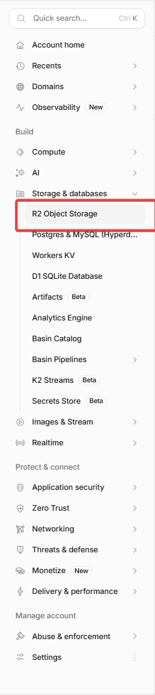
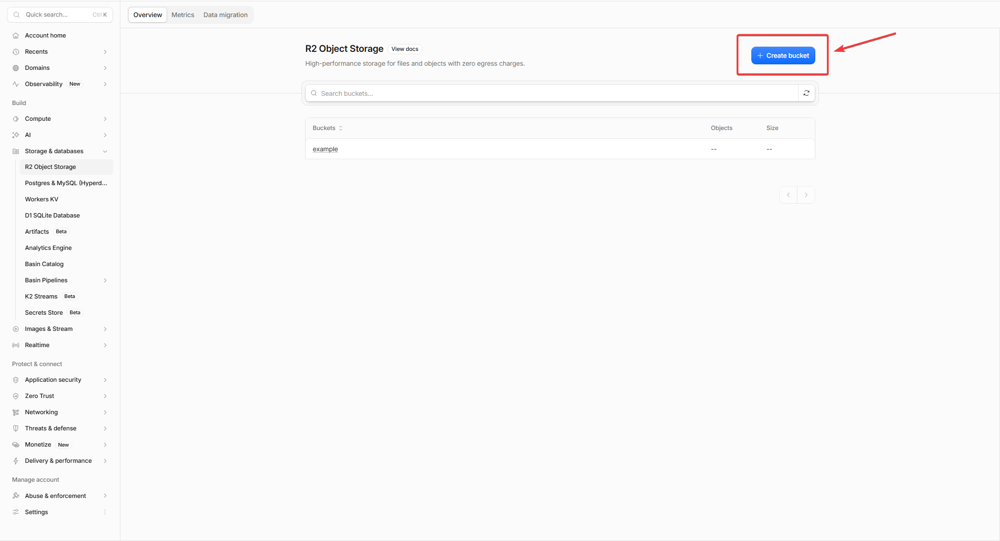
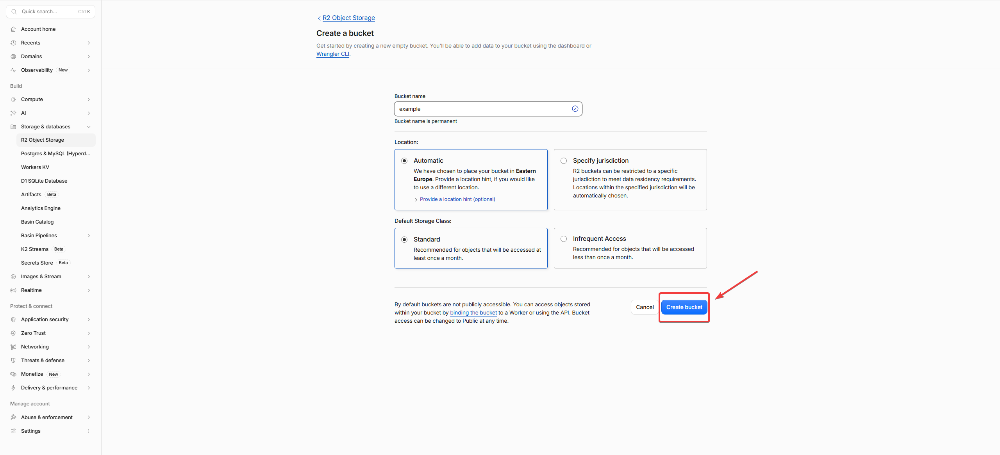
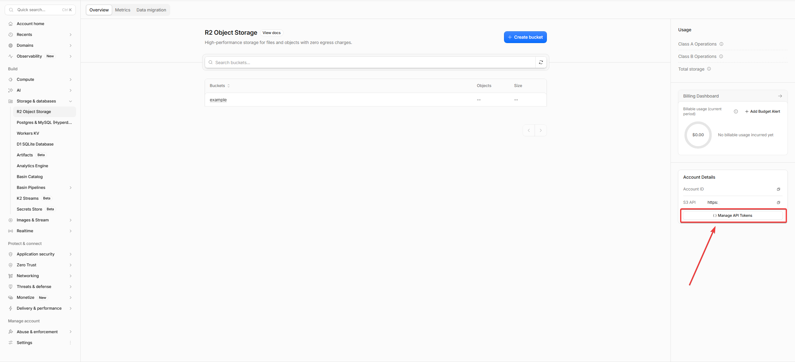
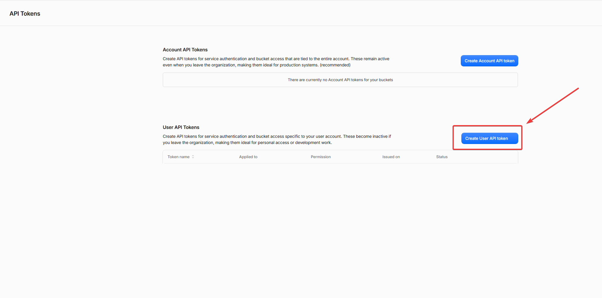
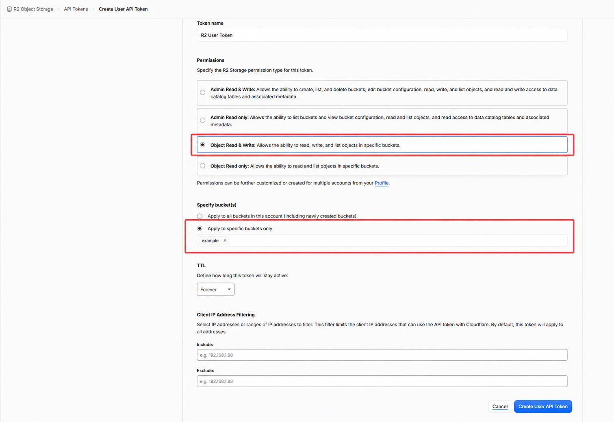
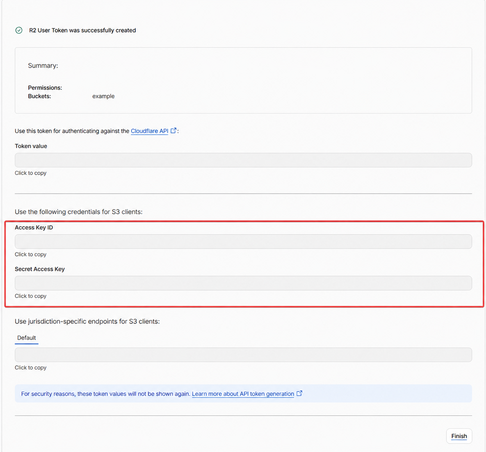
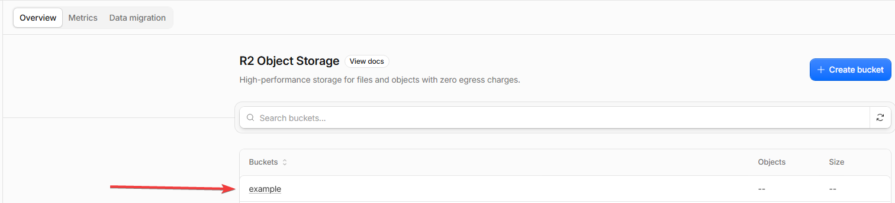
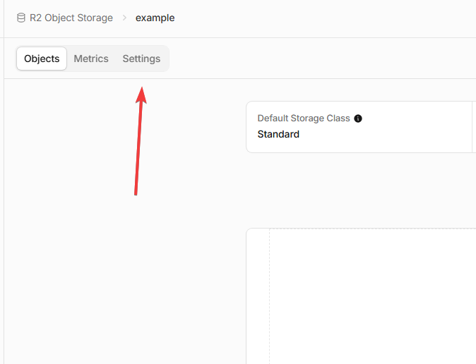

# Як підключити Cloudflare R2 до JetVideo

[English](R2_SETUP.md) · [Русский](R2_SETUP.ru.md) · [До основного посібника](../README.uk.md)

**R2 — сховище для відео перед публікацією.** JetVideo завантажує туди файли, а Buffer отримує їх за посиланням і публікує в TikTok за розкладом. Для нарізки й монтажу на комп’ютері R2 і Buffer не потрібні.

На знімках сховище називається **example**. Використовуйте свою назву.

У довідці JetVideo натисніть на знімок або його підпис. Щоб прочитати дрібний текст, натисніть **100%** чи **+** або прокрутіть коліщатко з утриманням **Ctrl**. Збільшений знімок можна пересувати мишею. Кнопка **Вписати** знову покаже весь знімок.

## 1. Створіть bucket

1. Увійдіть у [панель Cloudflare](https://dash.cloudflare.com/). Ліворуч відкрийте **Storage & databases** → **R2 Object Storage**. Якщо Cloudflare запропонує підключити R2, спочатку завершіть підключення.

2. Натисніть **Create bucket**. Bucket — це окреме сховище, схоже на папку в хмарі.

3. У **Bucket name** введіть, наприклад, `jetvideo-media`. Використовуйте малі латинські літери, цифри й дефіси. Залиште **Automatic** і **Standard**, а потім натисніть **Create bucket**. Запам’ятайте точну назву для поля **R2 Bucket** у JetVideo.

[Посібник Cloudflare зі створення bucket](https://developers.cloudflare.com/r2/buckets/create-buckets/)

## 2. Створіть ключі для JetVideo

1. Поверніться на сторінку **R2 Object Storage → Overview**. Праворуч у **Account Details** натисніть **Manage API Tokens**.

2. У блоці **User API Tokens** натисніть **Create User API token**.

3. Назвіть ключ, наприклад `JetVideo`. У **Permissions** виберіть **Object Read & Write**. Далі виберіть **Apply to specific buckets only** і додайте лише створений bucket. Натисніть **Create User API Token**. Дозвіл лише на читання не дає JetVideo завантажувати відео. Права адміністратора для цього не потрібні.

4. У блоці **Use the following credentials for S3 clients** скопіюйте **Access Key ID** і **Secret Access Key**. Нижче скопіюйте **S3 endpoint** із **Default**, якщо під час створення bucket залишили **Automatic**. Адресу також показано в полі **S3 API** на сторінці **Overview**.

Скопіюйте секретний ключ перед закриттям сторінки. Cloudflare показує його лише один раз. JetVideo потрібні два ключі з блоку S3. Окреме поле **Token value** залиште невикористаним. Зберігайте ключі приватно й вводьте їх у своїй копії JetVideo. [Ключі S3 для R2](https://developers.cloudflare.com/r2/api/tokens/)

## 3. Отримайте публічну адресу для Buffer

1. Відкрийте **R2 Object Storage** та натисніть назву свого bucket.

2. Перейдіть на вкладку **Settings**.

3. Для пробної публікації знайдіть **Public Development URL** і натисніть **Enable**. Введіть `allow` у вікні підтвердження та натисніть **Allow**. Скопіюйте HTTPS-адресу на зразок `https://pub-<ваш-код>.r2.dev`. Це ваш **R2 Public URL**. Якщо ви вже підключили публічний домен у **Custom Domains**, використовуйте його HTTPS-адресу. Для регулярної роботи Cloudflare рекомендує власний домен.

Файли будуть доступні всім, хто має посилання. Тримайте в цьому bucket лише відео для публікації. Посилання на відео має працювати до виходу публікації. [Публічний доступ у Cloudflare](https://developers.cloudflare.com/r2/buckets/public-buckets/) · [Вимоги Buffer до посилань](https://developers.buffer.com/guides/hosting-media.html)

## 4. Заповніть поля в JetVideo

Відкрийте **Публікації** → **Підключення**. Вставте свої значення без лапок і пробілів на початку та в кінці.

| Поле в JetVideo | Звідки взяти значення |
| --- | --- |
| **Buffer API Key** | Власний ключ із Buffer. [Як отримати ключ Buffer](BUFFER_SETUP.uk.md) |
| **R2 Endpoint** | Адреса **S3 API** у Cloudflare на зразок `https://<account-id>.r2.cloudflarestorage.com`. Скопіюйте її без назви bucket у кінці. |
| **R2 Access Key ID** | **Access Key ID** із блоку S3. |
| **R2 Secret Access Key** | **Secret Access Key** із блоку S3. |
| **R2 Bucket** | Точна назва сховища, наприклад `jetvideo-media`. |
| **R2 Public URL** | HTTPS-адреса з **Public Development URL** або адреса публічного домену без назви файлу. |

JetVideo завантажує файли через **R2 Endpoint**. Buffer отримує їх через **R2 Public URL**. Скопіюйте дві адреси з відповідних розділів Cloudflare. [Де знайти ключ Buffer](https://developers.buffer.com/guides/authentication.html)

## 5. Перевірте підключення

1. Натисніть **Зберегти підключення**. Переконайтеся, що канал TikTok уже підключено в Buffer.
2. У JetVideo відкрийте **Акаунти** → **Прив’язати Buffer** → **Знайти в Buffer**. Виберіть канал і натисніть **Зберегти прив’язку**.
3. Поверніться до **Підключень** і натисніть **Перевірити підключення**. JetVideo перевірить Buffer, запише невеликий тестовий файл у R2 і прочитає його за публічним посиланням. Потім програма спробує видалити тестовий файл. Результат з’явиться в **Журналі дій**. Перевірка не створює публікацій.

| Що бачите | Що перевірити |
| --- | --- |
| **403 / AccessDenied / R2 credentials/bucket error** | Перевірте дозвіл **Object Read & Write** саме для вашого bucket, його назву, ключі й адресу S3. |
| **R2 працює, але публічна адреса недоступна** | Перевірте **R2 Public URL** і стан публічного доступу в **Settings**. Базова адреса може не показувати список файлів. JetVideo перевіряє посилання на конкретний файл. |
| **Канал TikTok відсутній** | Підключіть канал у Buffer і виберіть його в **Акаунтах**. Перевірте, чи ключ належить потрібному акаунту Buffer. |

Після успішної перевірки перейдіть до розділу **Планування публікацій** в [основному посібнику](../README.uk.md).
